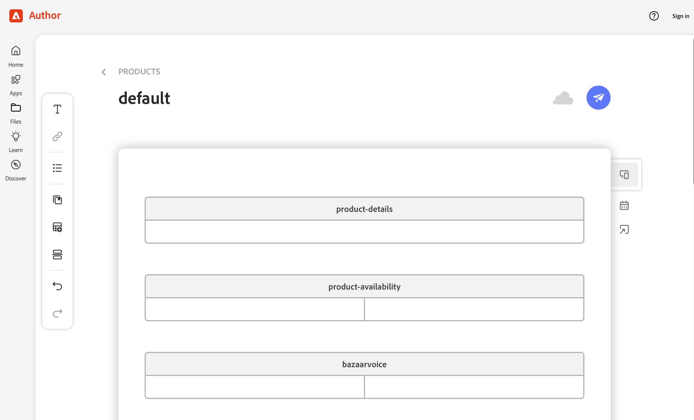

# EDS and Storefront Blocks

Blocks are how display reviews from within Edge Delivery Services and Adobe Commerce Storefront. They are easy to setup and configure, but require the app to be properly configured before they can work.

## Installation

This guide assumes you have a compatible Edge Delivery Services installation already.

1. Copy the block directories in this `blocks/` directory into your storefront's `blocks` directory.

2. Commit and deploy these to your aem.page or aem.live instances to enable them.

3. Point the storefront at the app's public config action. With the drop-in config service, add under `public.default`:

```
"yotpo-config-url": "https://<namespace>.adobeioruntime.net/api/v1/web/yotpo/public-config"
```

With the legacy `configs.json` sheets, add a `yotpo-config-url` row with the same value. The deploy output prints the action URL. Use the stage workspace's URL in the stage config and the production URL in the production config.

The blocks send the storefront's store view code (`headers.cs.Magento-Store-View-Code`), so each store view gets the settings configured for its scope in App Management.

4. In your _content repository_ such as https://da.live/, navigate to the `<store>/products/default` document, and create a block named `yotpo`, like so:



5. Test your storefront and ensure reviews are showing up correctly. Be sure to configure the app in Commerce Admin under Apps > App Management.
